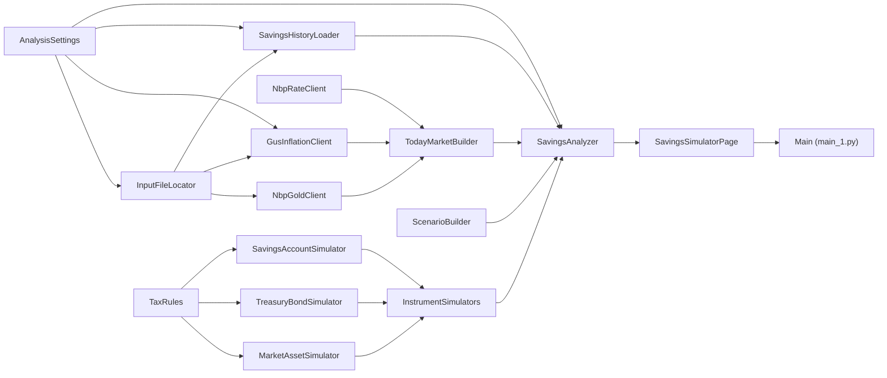

# Analiza oszczędności — kiedy uzbieram cel?

Interaktywny symulator dla osoby, która co miesiąc odkłada pieniądze i chce wiedzieć, **w którym
miesiącu uzbiera wybraną kwotę** (domyślnie 400 000 zł) — i gdzie zrobi to najszybciej. Porównuje
polskie instrumenty oszczędnościowe **na rękę**, po podatku Belki, opłatach i kosztach sprzedaży:

- **konta oszczędnościowe** z promocjami (stawka promocyjna, limit, stawka po promocji),
- **obligacje skarbowe** OTS, ROR, DOR, TOS, COI, EDO (oraz ROS i ROD dla rodzin 800+),
- **złoto inwestycyjne**, **fundusz obligacji krótkoterminowych** i **globalny ETF akcyjny** —
  z rozrzutem wyników z symulacji Monte Carlo (mediana, p10–p90, szansa osiągnięcia celu).

Cel można rozumieć jako **wartość przyszłą** (tyle złotych w dniu uzbierania) albo **dzisiejszą**
(siła nabywcza dzisiejszych złotych, rosnąca z inflacją). Aktualną inflację, stopę NBP i historię
cen złota program pobiera z oficjalnych, darmowych źródeł.

Projekt jest zbudowany w CatNip — wizualnym edytorze Pythona opartym na blokach. Każdy blok to jedna
klasa w osobnym pliku `.py` z własną stroną dokumentacji `.md`.

> [!WARNING]
> **To jest projekt poglądowy (edukacyjny), a nie porada inwestycyjna.**
> Program nie rekomenduje żadnego instrumentu, banku ani funduszu. Oprocentowanie kont i obligacji
> przepisano ręcznie z publicznych źródeł (stan na 13.10.2026) — oferty zmieniają się co kilka tygodni,
> mogą być nieaktualne lub obarczone błędem i **nie są ofertą** żadnej instytucji. Przyszła inflacja,
> stopy procentowe i zwroty ze złota, funduszy i akcji są **założeniami**, a nie prognozami; wyniki
> historyczne nie gwarantują przyszłych. Złoto, fundusze i ETF mogą przynieść stratę. Uproszczenia
> modelu (m.in. podatki, opłaty, warunki promocji) mogą odbiegać od rzeczywistych warunków. Przed
> decyzją sprawdź aktualne warunki u źródła, a w razie wątpliwości skonsultuj się z licencjonowanym
> doradcą inwestycyjnym. Autor nie ponosi odpowiedzialności za decyzje podjęte na podstawie wyników
> programu.

## Co pokazuje strona

- **Ranking** instrumentów według czasu dojścia do celu przy wybranej wpłacie (oraz przy 3 500 i 4 000 zł).
- **Najszybciej / najwolniej** — data, instrument i cel przeliczony na dzisiejsze i przyszłe złote.
- **Wykres wartości netto** w czasie z linią celu (opcjonalnie w dzisiejszych złotych).
- **Rozrzut Monte Carlo** (p10–p90 i mediana) dla ETF, złota albo funduszu.
- **Inflacja GUS**, oferty kont i obligacji, historia wpłat, założenia i źródła danych.

## Kontrolki

| Kontrolka | Zakres | Znaczenie |
|---|---|---|
| Wpłata miesięczna | 3 000–5 000 zł | Wyższa skraca czas dojścia. |
| Cel | 50 000–2 000 000 zł | Kwota do uzbierania (domyślnie 400 000 zł). |
| Tryb celu | przyszła / dzisiejsza | Cel nominalny albo w sile nabywczej dzisiejszych złotych. |
| Kapitał startowy | ≥ 0 zł | Domyślnie suma historii wpłat z `Input/Savings.xlsx`. |
| Horyzont | 5–30 lat | Długość symulacji i wykresów. |
| Wpłaty indeksowane | wł./wył. | Wpłaty rosną z inflacją. |
| Inflacja dziś / docelowa / czas dojścia | −1…12% / 0–60 mies. | Ścieżka inflacji; wpływa na COI, EDO, ROS, ROD i wartości realne. |
| Stopa NBP docelowa / czas dojścia | 0–10% / 0–36 mies. | Ścieżka stopy; wpływa na ROR, DOR i konta. |
| Erste: stawka, limit, stawka ponad limit | 0–8%, zł, 0–5% | Parametry konta Erste. |
| Promocje odnawiane | wł./wył. | Zakłada przenoszenie środków do kolejnych promocji. |
| Złoto: wzrost, zmienność, marża, dyskonto | −5…15%, 0–40%, 0–10%, 0–10% | Założenia dla złota. |
| Fundusz: zwrot | 0–10% | Zwrot funduszu po opłatach. |
| ETF: zwrot, zmienność | −2…15%, 0–40% | Założenia dla ETF. |
| Obligacje rodzinne | wł./wył. | Pokazuje ROS i ROD (tylko dla rodzin 800+). |

Przycisk **„Przywróć parametry z dziś”** wraca do wartości startowych.

## Dane

| Źródło | Co | Jak |
|---|---|---|
| **NBP** | Stopa referencyjna | Plik XML NBP przy każdym uruchomieniu; bez sieci wartość zapasowa 3,75%. |
| **NBP** | Ceny złota od 2013 r. | API NBP; kopia w `output/nbp_gold.json`. |
| **GUS** | Inflacja CPI od 2010 r. | CSV GUS + API Dziedzinowej Bazy Wiedzy; kopia w `output/gus_cpi.json` na 24 h. |
| Ręcznie | Oferty kont, obligacji, założenia funduszu i ETF | W bloku `TodayMarketBuilder` (stan 13.10.2026), ze źródłami na stronie. |
| Ty | Historia wpłat | `Input/Savings.xlsx` (opcjonalnie). |

**Historia wpłat** to plik Excel w `Input/` z kolumnami **Data** i **Kwota** w pierwszym arkuszu — suma
wpłat staje się kapitałem startowym. Plik **nie jest przechowywany w repozytorium**, bo zawiera Twoje
finanse. Bez niego program startuje z kapitałem 0 zł, a kapitał można ustawić suwakiem.

## Wymagania

- **Python 3.9 lub nowszy**.
- Pakiety z [`requirements.txt`](requirements.txt): `numpy`, `openpyxl`.
- **Dostęp do internetu** przy pierwszym uruchomieniu (NBP, GUS). Potem program korzysta z kopii
  w `output/`, gdy sieć nie działa.
- **CatNip** — do wyświetlenia interaktywnej strony.

## Instalacja

```bash
git clone <adres-repozytorium>
cd SavingsAnalysys

python -m venv .venv
# Windows:
.venv\Scripts\activate
# Linux / macOS:
source .venv/bin/activate

pip install -r requirements.txt
```

## Uruchomienie

### W CatNip (zalecane)

1. Otwórz `SavingsAnalysys.catnip` w CatNip.
2. Opcjonalnie: wrzuć swoją historię wpłat do `Input/Savings.xlsx`.
3. Wybierz środowisko Pythona z zainstalowanymi pakietami (venv) i uruchom przepływ (Run).
4. Strona pojawi się w zakładce **Output** i przelicza się po każdej zmianie kontrolki (0,04–0,5 s).

### Bez CatNip

```bash
python main_1.py
```

Dane zostaną pobrane, a w konsoli pojawi się ranking dla parametrów domyślnych. Interaktywną stronę
wyświetla jednak tylko Run Engine CatNip — poza nim zostanie wypisany jedynie komunikat, że strony nie
ma gdzie pokazać.

## Struktura projektu



### Bloki, które wykonują pracę

| Blok | Do czego służy |
|---|---|
| `AnalysisSettings` | Cel, zakres wpłat, horyzont, liczba ścieżek Monte Carlo, ziarno, pliki wejściowe. |
| `InputFileLocator` | Znajduje `Input/` i `output/` — lokalnie i w Dockerze. |
| `SavingsHistoryLoader` | Czyta historię wpłat z Excela (bez pliku: kapitał 0 zł). |
| `GusInflationClient` | Inflacja CPI z GUS z ostrożnym podejściem do limitu zapytań i kopią lokalną. |
| `NbpRateClient` | Stopa referencyjna NBP (z wartością zapasową). |
| `NbpGoldClient` | Historia cen złota z API NBP z kopią lokalną. |
| `TodayMarketBuilder` | Rynek „na dziś”: dane na żywo + spisane oferty kont, obligacji i założenia aktywów. |
| `ScenarioBuilder` | Ścieżki inflacji i stopy NBP oraz poziom cen. |
| `TaxRules` | Podatek Belki i PIT od szybkiej sprzedaży złota. |
| `SavingsAccountSimulator` | Konto oszczędnościowe miesiąc po miesiącu (limit, promocja, kapitalizacja). |
| `TreasuryBondSimulator` | Obligacje skarbowe: kupony, kapitalizacja, indeksacja, rollover, opłaty za wcześniejszy wykup. |
| `MarketAssetSimulator` | Złoto, fundusz i ETF — wariant równy i Monte Carlo (log-normalny). |
| `InstrumentSimulators` | Łączy trzy symulatory w jedno wejście analizatora. |
| `SavingsAnalyzer` | Serce obliczeń: ranking, cel w dzisiejszych i przyszłych złotych, Monte Carlo. |
| `SavingsSimulatorPage` | Interaktywna strona raportu. |
| `Main` | Punkt wejścia; z niego CatNip generuje `main_1.py`. |

### Rekordy danych (`@dataclass`)

| Blok | Co przechowuje |
|---|---|
| `SavingsDeposit`, `SavingsHistory` | Wpłata i historia wpłat. |
| `CpiReading`, `CpiHistory` | Odczyt inflacji i jego historia. |
| `NbpRate`, `GoldHistory` | Stopa NBP i historia cen złota. |
| `AccountOffer`, `BondSpec`, `MarketAssetSpec` | Oferta konta, parametry obligacji, parametry aktywa rynkowego. |
| `MarketAssumptions` | Wszystkie dane rynku „na dziś”. |
| `ScenarioParams`, `Scenario` | Założenia makro i zbudowane z nich ścieżki. |
| `ValueCurve`, `BondLot`, `Instrument` | Krzywa wartości, partia obligacji, instrument w rankingu. |
| `AnalysisResult` | Wszystko, co pokazuje strona dla jednego zestawu parametrów. |

Każdy blok ma swoją szczegółową dokumentację w pliku `<NazwaBloku>.md`.

### Pliki i foldery

| Ścieżka | Opis | W repozytorium |
|---|---|---|
| `SavingsAnalysys.catnip` | Projekt CatNip (graf bloków). | tak |
| `*.py`, `*.md` | Kod i dokumentacja bloków; `main_1.py` — wygenerowany punkt wejścia. | tak |
| `requirements.txt` | Zależności Pythona. | tak |
| `Input/` | Twoja historia wpłat (`Savings.xlsx`). | nie |
| `output/` | Kopie danych NBP i GUS. | nie |

## Konfiguracja

- **Cel, wpłaty, horyzont, Monte Carlo** — konstruktor `AnalysisSettings` (domyślnie 400 000 zł,
  3 500–4 000 zł/mies., 20 lat, 500 ścieżek, ziarno 2026).
- **Oferty kont i obligacji** — `TodayMarketBuilder` (`accounts()`, `bonds()`, `assets()`); aktualizuj
  co kilka tygodni ze źródeł z `sources()`.
- **Podatki** — `TaxRules` (Belka 19%, PIT od złota 12%, zwolnienie po 6 miesiącach).

## Licencja

Licencja nie została jeszcze wybrana — do czasu dodania pliku `LICENSE` wszystkie prawa zastrzeżone.
Dane NBP i GUS podlegają zasadom udostępniania tych instytucji.

## Zastrzeżenie

Projekt ma charakter wyłącznie **poglądowy i edukacyjny**. Nie stanowi porady inwestycyjnej, finansowej
ani podatkowej, ani rekomendacji w rozumieniu przepisów o obrocie instrumentami finansowymi. Inwestowanie
wiąże się z ryzykiem utraty części kapitału. Wszelkie decyzje podejmujesz na własną odpowiedzialność.
